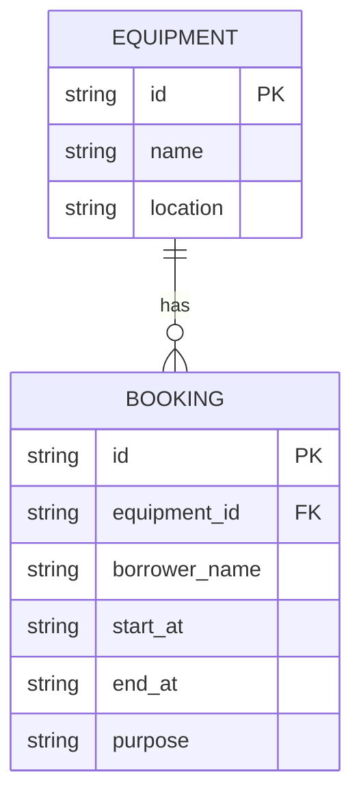

# Campus Equipment Booking API

A small REST API for reserving shared campus equipment. It uses TypeScript, Hono, and Cloudflare Workers with D1. The existing Node/SQLite path remains available for local tests.

## Run

Node/SQLite development:

```bash
npm install
npm run dev
```

Local API base URL: `http://localhost:8787/api`

Deployed Cloudflare API base URL: `https://campus-equipment-booking-api.neon-dev.workers.dev/api`

The deployed API runs on Cloudflare Workers and uses Cloudflare D1. Deployed Worker version: `eb4d84bd-5930-4715-a56d-ffa982cc8634`.

The Node development server uses `./data.db`. Set `DATABASE_FILE` to use another SQLite file. The first run creates the schema and seeds two equipment records.

## Cloudflare Workers and D1

Install dependencies, generate binding types, and create a D1 database:

```bash
npm install
npm run types
npx wrangler d1 create DB
```

Put the returned database ID into `wrangler.jsonc` as `database_id`. The Worker binding is named `DB`.

Apply the existing migration to local D1, then start the Worker locally:

```bash
npx wrangler d1 migrations apply DB --local
npm run dev:worker
```

The Worker is served at `http://localhost:8787`. Run the same API requests from `API_CONTRACT.md` against `/api`.

Apply the migration to the remote D1 database and deploy the Worker only after reviewing the target database ID:

```bash
npx wrangler d1 migrations apply DB --remote
npm run deploy
```

`wrangler.jsonc` points Wrangler at `src/index.ts`, binds D1 as `env.DB`, and uses the `migrations/` directory. Do not commit credentials or local `.wrangler/` state.

## Verify

```bash
npm test
npm run build
npm run types
```

Live curl evidence is recorded in `API_CONTRACT.md`.

## Schema / ERD



A booking references one equipment record. The API checks the interval rule before insert and update:
`new_start < existing_end AND new_end > existing_start`.

## Design notes

- SQL values use SQLite parameter binding.
- POST requires all booking fields; PATCH accepts one or more fields.
- PATCH merges with the stored booking, validates the complete result, and excludes its own ID from conflict checking.
- Invalid data returns `400`, missing resources return `404`, conflicts return `409`, and all errors are JSON objects with an `error` property.
