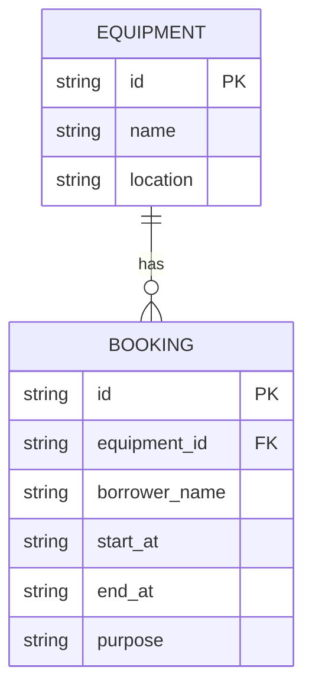

# Campus Equipment Booking API

A small REST API for reserving shared campus equipment. It uses TypeScript, Hono, and local SQLite.

## Run

```bash
npm install
npm run dev
```

Base API URL: `http://localhost:8787/api`

The default database is `./data.db`. Set `DATABASE_FILE` to use another SQLite file. The first run creates the schema and seeds two equipment records.

## Verify

```bash
npm test
npm run build
```

Live curl evidence is recorded in `API_CONTRACT.md`.

## Schema / ERD



A booking references one equipment record. The API checks the interval rule before insert and update:
`new_start < existing_end AND new_end > existing_start`.

## Design notes

- SQL values use SQLite parameter binding.
- POST requires all booking fields; PATCH accepts one or more fields.
- PATCH merges with the stored booking, validates the complete result, and excludes its own ID from conflict checking.
- Invalid data returns `400`, missing resources return `404`, conflicts return `409`, and all errors are JSON objects with an `error` property.
